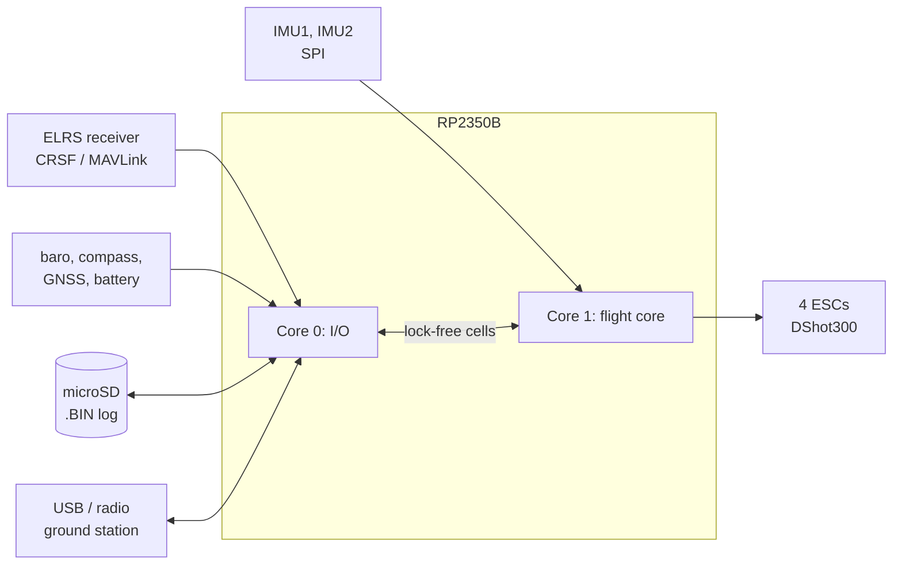

# MARV V2 firmware

Quadcopter flight-controller firmware for the MARV V2 board (RP2350B), written in Rust with embassy. It runs on both cores: core 1
is the flight core (two IMUs, estimator, controllers, motor output, all from SRAM) and core 0 does the I/O (USB and radio MAVLink,
receiver, slow sensors, SD log, settings, health). Hardware-free logic lives in three workspace crates so it can be tested on the
host and reused by the simulator.



## How it fits together

| Repository | Role |
|---|---|
| This repo | The firmware and its three crates ([fw-core](crates/fw-core/README.md), [fw-flight](crates/fw-flight/README.md), [fw-settings](crates/fw-settings/README.md)) |
| [MARV-GCS](https://github.com/Lmx154/MARV-GCS) | Ground station (`marv-gcs`) and command line (`marv-cli`); see [ground-station](docs/ground-station.md) |
| [MARV-sim](https://github.com/Lmx154/MARV-sim) | Simulator that runs this repo's real flight code |
| Driver crates | One repository each, pinned by commit in `Cargo.toml`: [icm45686](https://github.com/Lmx154/icm45686-rs), [lsm6dsk320x](https://github.com/Lmx154/lsm6dsk320x-rs), [bmp581](https://github.com/Lmx154/bmp581-rs), [bmm350](https://github.com/Lmx154/bmm350-rs), [sam-m10q](https://github.com/Lmx154/sam-m10q), [adc-battery](https://github.com/Lmx154/adc-battery), [dshot](https://github.com/Lmx154/dshot-rs), [pio-sdmmc](https://github.com/Lmx154/pio-sdmmc-rs), [qmi-psram](https://github.com/Lmx154/qmi-psram-rs), [ws2812c](https://github.com/Lmx154/ws2812c-rs), [usb-cdc](https://github.com/Lmx154/usb-cdc), [mavlink-device](https://github.com/Lmx154/mavlink-device), [rc-port](https://github.com/Lmx154/rc-port) |

## Nodes

Each part of the firmware has one page; start with the architecture.

| Node | In one line |
|---|---|
| [architecture](docs/architecture.md) | Two cores, tasks, cross-core cells, boot, memory layout |
| [flight-core](docs/flight-core.md) | IMU loop, flight step, estimators, controllers, mixer |
| [flight-modes](docs/flight-modes.md) | Modes, CRSF versus MAVLink, channel map, arming, mission switch, failsafes |
| [missions](docs/missions.md) | Waypoint upload, Start checks, AUTO and RETURN guidance |
| [parameters](docs/parameters.md) | How parameters work and the ones that matter |
| [device-layer](docs/device-layer.md) | Device rows, health machine, sensor rows |
| [radio](docs/radio.md) | ELRS receiver, CRSF and MAVLink, telemetry, the USB and radio MAVLink node |
| [esc](docs/esc.md) | DShot, ESC telemetry, motor layout, motor test |
| [logging](docs/logging.md) | SD card, `.BIN` log, record types, log download |
| [calibration](docs/calibration.md) | Frames, orientation, gyro, accelerometer, compass |
| [health](docs/health.md) | Supervisor, `[STAT]` lines, watchdog, status LED |
| [ground-station](docs/ground-station.md) | marv-gcs and marv-cli, commands, recording a session |
| [build-and-test](docs/build-and-test.md) | Build, flash, host tests, guards, feature flags |
| [pinout](docs/pinout.md) | Board pin assignment |
| [resources](docs/resources.md) | Which user has which pin, PIO state machine, DMA channel and interrupt |
| [devices](docs/devices.md) | Sensor register facts |
| [src](src/README.md), [tools](tools/README.md) | File maps of the binary and the scripts |

## Quick start

```
cargo build --release     # firmware for the board
tools/run.sh 90           # build, RAM guard, flash through the probe, run 90 s
cargo host-test -p fw-flight    # host tests (also -p fw-core, -p fw-settings)
```

Needs the Rust toolchain with `thumbv8m.main-none-eabihf`, `probe-rs`, python3 and arm-none-eabi-binutils. More in
[build-and-test](docs/build-and-test.md).

## Status

- Tested on the host (flight, core and settings crates), in the simulator (mission-switch flights end to end), and on the bench with props off (mode transitions, Start and AUTO, RETURN, LAND, take-over, arming refusals, mission upload).
- HOLD, AUTO, RETURN, LAND's touchdown stop, TAKEOVER and the mission switch have never been in the air.
- Hand flying on the MAVLink receiver model has not been flown; BLIND, waypoint arrival and the battery-critical exits have not run on the board.

Photos and videos go in `docs/media/`.

## Licence

MIT, see `LICENSE`.
