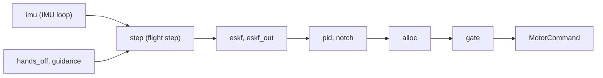

# fw-flight

Part of [MARV V2 firmware](../../README.md)

The flight core's logic: the IMU device loop, the estimator, controllers, allocator, gate, hands-off state machine and guidance.
Pure `no_std`, `forbid(unsafe_code)`, and no dependency on `embassy-time`, `embassy-sync` or `defmt`. Tested on the host
(`cargo host-test -p fw-flight`); the simulator reuses it unchanged.

| Module | What it is | Node |
|---|---|---|
| `imu` | `ImuTask`: device loop on data-ready, incremental verify | [flight-core](../../docs/flight-core.md) |
| `step` | `Flight::step`: one call per IMU1 sample, runs the stages in order | [flight-core](../../docs/flight-core.md) |
| `gnc` | The estimator, controller and allocator seams and their types | [flight-core](../../docs/flight-core.md) |
| `eskf`, `eskf_out` | Error-state Kalman filter and output predictor | [flight-core](../../docs/flight-core.md) |
| `mahony`, `mahony_baro` | Older attitude and vertical estimators | [flight-core](../../docs/flight-core.md) |
| `pid` | Attitude P into rate PID, vertical and position loops | [flight-core](../../docs/flight-core.md) |
| `notch` | RPM notch on the rate loop | [flight-core](../../docs/flight-core.md) |
| `alloc` | Thrust and torques to four rotor levels | [flight-core](../../docs/flight-core.md) |
| `gate` | Arming, disarming, RC-loss rule; the only maker of a spinning `MotorCommand` | [flight-modes](../../docs/flight-modes.md) |
| `hands_off` | The mode state machine and the mission switch table | [flight-modes](../../docs/flight-modes.md) |
| `station` | Station command mailbox to state machine command and ACK | [flight-modes](../../docs/flight-modes.md) |
| `guidance` | Leg guidance along the uploaded waypoints | [missions](../../docs/missions.md) |
| `tuning` | Gains and limits | [flight-core](../../docs/flight-core.md) |
| `esc` | Pure ESC telemetry logic for the ESC task | [esc](../../docs/esc.md) |
| `quat` | Vector and quaternion helpers (private) | [flight-core](../../docs/flight-core.md) |
| `eskf_n0` | 15-state ESKF arithmetic (nominal step, covariance, fusion) the estimator uses | [flight-core](../../docs/flight-core.md) |

`testdata/` holds a recorded ground run used by tests; `step/*_tests.rs` and `guidance/leg_tests.rs` are the behaviour tests.
Back to the [README](../../README.md).
