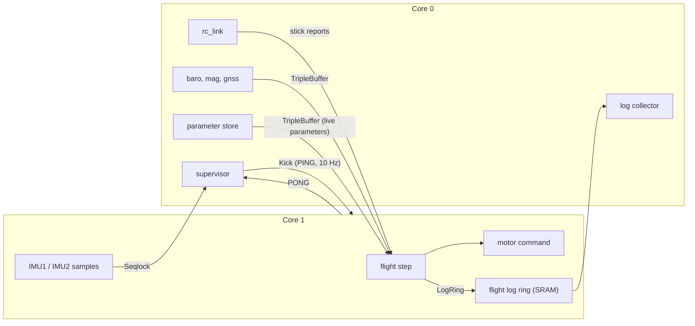
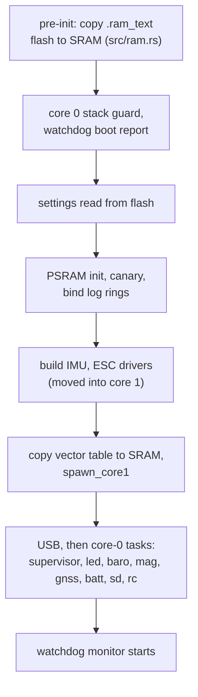
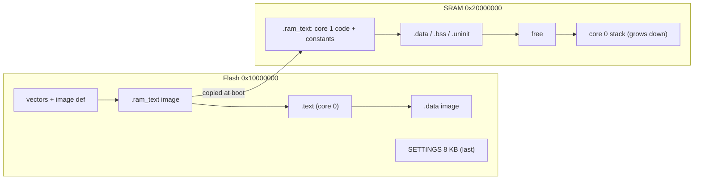

# Architecture

Part of [MARV V2 firmware](../README.md)

The firmware runs on both Cortex-M33 cores of the RP2350. Core 1 is the flight core: the IMU tasks, the flight step and the ESC
output, all executing from internal SRAM. Core 0 is the I/O core: USB, radio, the slow sensors, the SD log, settings and the
supervisor. Only lock-free cells and atomics cross between them.

## Core split

| Core | Runs | Rule |
|---|---|---|
| 1, flight core (16 KB stack) | IMU1 and IMU2 tasks, the flight step (once per good IMU1 sample, default 800 Hz), the ESC task (DShot300 at 1 kHz), the liveness answer | No log, no timer in the sample loop, no lock. Code, constants and vector table run from SRAM, so core 1 never touches flash or PSRAM |
| 0, I/O core | USB and radio MAVLink nodes, supervisor, barometer, compass, GNSS and battery tasks, SD writer and log collector, settings flash, status LED, mission service, station command bridge, watchdog monitor | Owns the flash, the PSRAM and the SD bus. Its stack grows down from the top of SRAM and is guarded by MSPLIM |

DMA channels 0-3 and 5 and `DMA_IRQ_0` belong to core 1 (IMU SPI buses and the ESC reply capture); the SD bus uses channel 4 on
`DMA_IRQ_1` on core 0. Start-up checks print `[PASS]`/`[FAIL]` for each of these assignments. Pins, PIO state machines, DMA
channels and interrupts by user: [resources](resources.md) and [pinout](pinout.md).

## Data between the cores

| Cell | Direction | Use |
|---|---|---|
| `Seqlock` | core 1 to core 0 | Status and samples of the IMU rows and the ESC telemetry: one writer that never waits |
| `TripleBuffer` | core 0 to core 1 | Slow-sensor samples, live parameters, calibration offsets: wait-free both ways |
| `Kick` | either | Request bits plus a lock-free wake (supervisor to IMU tasks, PING to the liveness task) |
| `LogRing` | core 1 to core 0 | Whole log records; the core-0 collector drains it into the main ring |

Code: `fw_core::xcore` (the only module with `unsafe`). Statics using these cells live in internal SRAM, and core 1 is started
with embassy-rp's `spawn_core1`.

## Boot sequence

The supervisor then prints the start-up `[PASS]`/`[FAIL]` report and a `[STAT]` line every 10 s (see [health](health.md)).

## Memory layout

| Region | Address | Content |
|---|---|---|
| Flash (program) | 0x10000000, 2040 KB | Vector table, boot image definition, the load image of `.ram_text`, core 0's code, the load image of `.data` |
| Flash (settings) | 0x101FE000, 8 KB | Two 4 KB sectors holding the parameter records (the only range the firmware erases or programs) |
| SRAM | 0x20000000, 512 KB | `.ram_text` (core 1's code, then all constants), `.data`, `.bss` (with core 1's vector table), `.uninit`; the rest is core 0's stack, growing down |
| PSRAM | 0x15000000, 16 MiB | Uncached alias; the 64-byte canary, the 1 MiB main log ring and the 4 KiB log-download handover. Core 0 only |

- **Flight core in SRAM.** `memory.x` adds the `.ram_text` output section, which picks core 1's functions by their v0-mangled
  names, then all `.rodata`. `src/ram.rs` copies it before anything else runs (the link wraps `__pre_init`). Link assertions
  keep the interrupt handlers in RAM, `.rodata` empty and at least 28 252 B free above the statics for core 0's stack.
- **Guard.** `tools/check-ram-code.py` follows everything core 1 can reach and fails on any flash or PSRAM address; see
  [build and test](build-and-test.md) and [tools](../tools/README.md).
- **Stack guards.** `memory.x` defines `_stack_end` and `main` calls `install_core0_stack_guard()`, so a core-0 stack overflow is
  a HardFault, not silent corruption; `spawn_core1` does the same for core 1.
- **PSRAM.** `psram::init` runs after settings are read and before core 1 starts, and is re-mapped after every settings flash
  operation. Without a working chip the log rings stay unbound, the SD task goes off (row Absent) and arming is not blocked.

## Code

| File | Role |
|---|---|
| `src/main.rs` | Entry, task spawns, USB node, supervisor, `core1_main` |
| `src/ram.rs` | Boot copy of `.ram_text` to SRAM |
| `src/psram.rs` | PSRAM start, canary, log-ring storage |
| `src/flight_latency.rs` | Longest-poll figure of the flight tasks |
| `memory.x`, `build.rs` | Linker layout, `__pre_init` wrap |

## Related

[flight-core](flight-core.md), [device-layer](device-layer.md), [health](health.md), [logging](logging.md),
[parameters](parameters.md), [resources](resources.md), [pinout](pinout.md), [build and test](build-and-test.md),
[fw-core](../crates/fw-core/README.md)
