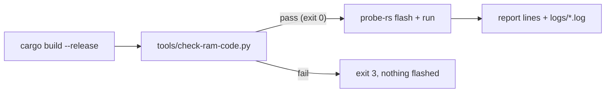

# Build and test

Part of [MARV V2 firmware](../README.md)

The firmware builds for the board (`thumbv8m.main-none-eabihf`) with `cargo`, is flashed and run through a debug probe by
`tools/run.sh`, and its pure logic is tested on the host. A guard script checks that nothing core 1 runs sits in flash.

## Needs

Rust toolchain with the `thumbv8m.main-none-eabihf` target, `probe-rs`, python3, arm-none-eabi-binutils (`readelf`, `objdump`)
and a debug probe on the board. The workspace default target is the board (`.cargo/config.toml`), so the host commands use aliases.

## Flow

## Commands

| Task | Command | Notes |
|---|---|---|
| Build for the board | `cargo build --release` | Drivers are fetched from GitHub, pinned by `rev` in `Cargo.toml` |
| Build, check, flash, run | `tools/run.sh 90` | Runs 90 s; exit 124 is the normal end; log kept under `logs/` |
| Re-attach, no flash | `ATTACH=1 tools/run.sh 60` | Reads the log of the image already running; build with the same `FEATURES` |
| Another binary | `BIN=eskf_bench FEATURES=eskf-bench tools/run.sh 60` | The ESKF timing bench (`src/bin/eskf_bench.rs`) |
| Host tests | `cargo host-test -p fw-core` (also `-p fw-flight`, `-p fw-settings`) | Alias for `test --target x86_64-unknown-linux-gnu`; plain `cargo test -p` picks the board and fails |
| Host lint | `cargo host-clippy -p fw-core -p fw-flight --all-targets` | |
| RAM-code guard alone | `python3 tools/check-ram-code.py <elf>` | Exit 0 pass, 1 flash reference found, 2 tool error |
| Dependency rule | `cargo tree -p fw-flight -e normal --depth 1 \| grep -cE 'embassy-time\|embassy-sync\|defmt'` | Prints 0: fw-flight must not depend on these |

`tools/run.sh` takes a probe lock so two runs do not collide, and flashes only when the guard gave the expected result. Parameters
and the uploaded mission are lost at every flash and power cycle unless saved. Details: [tools](../tools/README.md).

## Expected output

One `[INFO]` line per linked driver, then the start-up `[PASS]`/`[FAIL]` checks (which core handles DMA and PIO interrupts, flight
core vector table in SRAM, watchdog fed, `PONG` follows `PING`, SD bus checks), then a `[STAT]` line every 10 s. See
[health](health.md). USB enumerates as CDC (VID 0xc0de, PID 0xcafe, product "MARV V2 firmware"); the ground station is described
in [ground-station](ground-station.md).

## Negative controls

A check is only trusted if its negative control fails as expected.

| Feature | Expect |
|---|---|
| `no-fbeat` | Core 1 starts without its liveness task: `[FAIL] PONG follows PING`; the watchdog is not started |
| `ram-negative` | `now_us` linked into flash: the guard must FAIL naming it (`tools/run.sh` requires exit 1, then flashes) |
| `psram-negative` | Core 1's `now_us` reads PSRAM: the guard must FAIL (static check, never flashed) |
| `stack-negative` | A core-0 task overruns its stack: it must fault; without the guard it logs `[FAIL]` |
| `f4-negative` | A DMA channel built on core 0 before the start-up check: the check must FAIL |
| `guard-negative` | Settings flash writes outside the region are refused before any flash call |

## Feature flags

Cargo features are off by default; they add board checks and fault injections. Build with `FEATURES=<name> tools/run.sh <s>`.

| Group | Features | What they do |
|---|---|---|
| Fault injection, BARO | `inject-baro-transient`, `-persistent`, `-missed-edge`, `-silent`, `-verify`, `-por`, `-stuck`, `-fail-until-restart`, `-hang-once`, `-hang-boot`, `-hang-forever` | Wrap the barometer adapter or its I2C bus ([device-layer](device-layer.md)) |
| Fault injection, other devices | `inject-mag-fail-until-restart`, `inject-gnss-silent`, `inject-mag-rotation`, `inject-imu1-persistent`, `-imu1-missed-edge`, `inject-imu2-persistent`, `-imu2-verify`, `inject-late` | MAG, GNSS and IMU adapters; `inject-late` delays the IMU injections to 60 s so the vehicle can be armed first |
| SD and log | `inject-sd-no-card`, `inject-sd-wrong-format`, `inject-sd-write-fail`, `log-verify`, `inject-log-small-volume`, `inject-log-delete-big`, `sd-irq-negative` | Test hooks of the SD task ([logging](logging.md)) |
| Settings | `save-loop`, `fake-armed`, `corrupt-newest`, `guard-negative`, `save-foreign` | Flash save checks ([parameters](parameters.md)) |
| Watchdog | `hang-core0`, `hang-flight`, `spin-1s`, `hang-irqoff`, `stall-core0` | Each acts once, 20 s after a start the watchdog did not cause ([health](health.md)) |
| PSRAM | `psram-skip-remap`, `psram-absent`, `psram-negative` | PSRAM checks |
| Measurement | `xip-park`, `quiet-stat`, `eskf-bench` | Parked-core check, silent `[STAT]`, ESKF bench |
| Bench, PROPS OFF | `restart-bench` | The in-air restart on the bench (below); never for flight |

**`restart-bench` (props off only).** Measures how fast the motors spin up when the in-air restart re-arms
([flight-modes](flight-modes.md), decision-inair-restart-20261125). With it, every arm-OFF STOP, on the ground too, opens the
5 s restart window and the free-fall test reads true, so arm back ON within 5 s re-arms at once with the throttle wherever it
is (no throttle-low check). Bench steps: remove the props; build and flash with `FEATURES=restart-bench tools/run.sh <s>`; arm
normally, raise the throttle, flip arm OFF, wait the delay under test (0 to 5 s), flip arm ON. The SD log has `HO 7 STOP`,
`ARM fall t=<delay ms> ... thr=<x100>` at the re-arm, and the ESC records (eRPM by line) give the spin-up from that time.
After 5 s the arm ON is refused (`ARM no thr`) as in the flight image. The default build does not have it.

## Related

[architecture](architecture.md), [tools](../tools/README.md), [health](health.md), [parameters](parameters.md),
[fw-core](../crates/fw-core/README.md), [fw-flight](../crates/fw-flight/README.md), [fw-settings](../crates/fw-settings/README.md)
