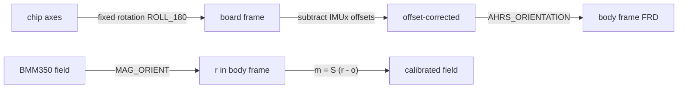

# Calibration

Part of [MARV V2 firmware](../README.md)

Every IMU and compass value that leaves the board is in the body frame, FRD (x forward, y right, z down), as in MAVLink and ArduPilot.
Three calibrations (gyro, accelerometer, compass) are started by `marv-cli calibrate ...` (MAV_CMD_PREFLIGHT_CALIBRATION 241). The
logic is pure and host-tested (`fw_core::calib`); the glue is `src/calibration.rs` on core 0, stepped from the supervisor tick.

## Frames

Level and at rest the accelerometer reads z about -9.81 m/s^2. The log's IMU and MAG records and the `[STAT]` lines carry the same values as the link.
All offsets are subtracted in software; the chips' own offset registers stay 0.

## The calibrations

| Command | Sensors | Method | Duration | Result text | Failure texts |
|---|---|---|---|---|---|
| `calibrate gyro` | IMU1, IMU2 | mean of 125 samples is the offset; fails if any axis std deviation exceeds 2.93 dps | about 1.25 s | "gyro cal: \|IMU1\| N \|IMU2\| N urad/s" | "moving", "offset out of range", "no IMU Ok" |
| `calibrate accel` | IMU1, IMU2, level, one position | averages of 50 samples; converged when two successive averages differ by under 0.05 m/s^2; offset = mean minus gravity; max one gravity per axis | 1 to 10 s | "accel cal: \|IMU1\| N \|IMU2\| N mm/s^2" | "moving", "IMUn offset too large", "no IMU Ok" |
| `calibrate compass` | MAG, best effort | the user turns the vehicle through all orientations; offset = (min + max) / 2 per axis; each radius must be between 15 and 95 uT | 30 s | "compass cal: off X Y Z r X Y Z uT" | "not rotated", "offset out of range", "MAG not ok" |
| guided compass | MAG, done by the station | the station fits S and o from six poses and writes parameters | station-driven | read back by the station | station's messages |
| `calibrate cancel` | any running | drops the run, nothing is written | | final ACK CANCELLED | |

A device that is not Ok is skipped (named in a text); one IMU moving fails the whole gyro run.

## Rules common to all

- One calibration at a time (the one `ActionBook`); progress 0 to 100 % goes out through the book, HEARTBEAT `system_status` is CALIBRATING and the status LED alternates blue and white.
- The result is written into the parameters and used at once, but NOT saved to flash: only `param save` stores it, and a reset or `param reload` loses it. A failed or cancelled run writes nothing.
- Result or failure text is queued before the action ends, and the final ACK is held until that link's texts are taken (at most 300 ms).
- A calibration measures the RAW value: IMU calibrations add the offsets in force back to each sample (`ImuOffsets::restore`); the compass calibration takes the raw field r from the adapter. A second run with the first's result in force gives the same result.
- Core 0 pushes the IMU offsets into one triple buffer per IMU (at boot and within one supervisor tick of any change); pushes wait while a calibration runs.

## Compass model

m = S (r - o), in microtesla. o is `MAG_OFFX/Y/Z`; S is symmetric, from `MAG_DIAGX/Y/Z` and `MAG_ODIAGXY/XZ/YZ`. Other parameters: `MAG_CAL_TYPE`
(0 none, 1 quick, 2 guided), `MAG_FLD_UT`, `MAG_FLD_INC` (expected field and inclination from the World Magnetic Model, 0 = unset), `MAG_HLT_STR`, `MAG_HLT_INC` (flight health-test tolerances).
The adapter publishes the expected field to the flight core only when the type is 2 and `MAG_FLD_UT` > 0. Changing `MAG_ORIENT` invalidates the calibration; nothing on the board warns.
`param reset-calibration --yes` returns the offsets, S, type and expected field to defaults.

| State (as a station shows it) | Parameters |
|---|---|
| not calibrated | `MAG_CAL_TYPE` 0 and offsets all 0 |
| best effort | type 1, or type 0 with offsets |
| guided | type 2 with `MAG_FLD_UT` > 0 |

The quick calibration writes one coherent set in one store access: offsets = midpoints, S = identity, type 1, `MAG_FLD_UT` 0.
The guided one writes type 0, then the offsets, S, field and inclination, then type 2, and reads them back. The board has no fit, coverage or pose logic.
Not built: automatic or in-flight compass learning.

## Test feature

`FEATURES=inject-mag-rotation tools/run.sh` replaces the compass calibration's input with a synthetic rotation (six points of +-50 uT about (10, -20, 30)), so the success path runs on a board that cannot be turned (offsets (10, -20, 30), radii 50).

## Code

| File | Role |
|---|---|
| `src/calibration.rs` | firmware glue, stepped from the supervisor |
| `crates/fw-core/src/calib.rs` | the pure gyro, accel and compass logic |
| `crates/fw-core/src/rotation.rs` | rotations (`ROLL_180`, orientation parameters) |
| `crates/fw-settings/src/mag.rs` | `apply`, `write_quick_result` |
| `src/actions.rs` | admission and the action book tick |

## Related

[device-layer](device-layer.md) (IMU and MAG rows) - [parameters](parameters.md) (offsets, `MAG_*`, `AHRS_ORIENTATION`) - [ground-station](ground-station.md) (guided calibration, save) - [health](health.md) (LED) - [flight-core](flight-core.md)
