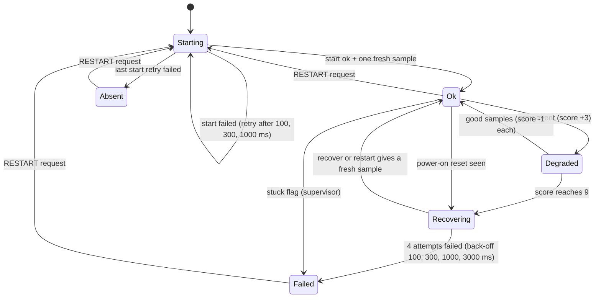

# Device layer

Part of [MARV V2 firmware](../README.md)

Every sensor on core 0 is a *device row*: one task running the same generic loop (`run_device`) over a
`DeviceAdapter`, stepping a pure health state machine (`fw_core::health::Health`) and carrying out the action it returns.
The rows are published as `MARV_DEVICE_STATUS` and drive the status LED, the supervisor texts and the arming permit.

## Health state machine

- Entering Recovering four times within 60 s makes the device Failed.
- *Stuck* is not a state: the supervisor sets a flag when the task's `progress` counter stands still for max(1 s, 20 P), and the row
  then reports FAILED with error STUCK. The board is not reset: a device stuck in an await does not stop core 0.
- "Started" and "recovered" mean data flows: after a start, `recover` or `restart` returns Ok the loop waits for one fresh sample
  before it tells `Health` the step worked.
- The supervisor turns transitions into one STATUSTEXT naming the device (entered Recovering WARNING, recovered NOTICE,
  Failed or Absent ERROR), at most one per device per second.

## Rows

| Row | Device | Bus | Period P | Deadline T | Stuck after |
|---|---|---|---|---|---|
| IMU1 | ICM-45686 | SPI0, DMA 0 and 1, INT1 GPIO15 (flight core, see [flight-core](flight-core.md)) | 1/800 s | per flight loop | max(1 s, 20 P) |
| IMU2 | LSM6DSK320X | SPI1, DMA 2 and 3, INT1 GPIO7 (flight core) | 1/800 s | per flight loop | max(1 s, 20 P) |
| BARO | BMP581 | I2C1 400 kHz, SDA GPIO22, SCL GPIO23, data-ready GPIO21 | 19.978 ms (50.056 Hz default) | max(3 P, 10 ms) = 59.9 ms | max(1 s, 20 P) |
| MAG | BMM350 | I2C0 400 kHz, SDA GPIO12, SCL GPIO13, data-ready GPIO4 | 10 ms (100 Hz default) | max(3 P, 10 ms) = 30 ms | max(1 s, 20 P) |
| GNSS | SAM-M10Q | UART1 115200, TX GPIO24, RX GPIO25, PPS GPIO5 | 1 s whatever the rate | 2.5 s | 20 s |
| BATT | RP2350 ADC | GPIO42 (battery voltage), GPIO41 (ESC current) | 100 ms (10 Hz) | 300 ms | 2 s |
| SD | microSD | PIO0 SM0, DMA 4, CLK GPIO32, CMD 33, DAT0-3 28-31 (see [logging](logging.md)) | 1 s | none | 20 s |
| RC | ELRS receiver | UART0 (see [radio](radio.md)) | report only | none | not supervised |
| ESC | four DShot ESCs | PIO2 (see [esc](esc.md)) | report only | none | not supervised |

P follows the configured rate for BARO and MAG (set at every start and apply), so T, the stuck threshold and the `[STAT]` rate follow it.
RC and ESC are not in the registry (`device::DEVICES`); their rows are computed for every message.

## The loop

- Sampling is `select(with_timeout(T, data ready), wake)`. A timeout makes ONE status read: data waiting is a missed edge (read it),
  nothing is a deadline miss.
- Requests: a row has APPLY and RESTART flags (plus its `wake` signal), taken at the top of the loop, never inside a bus call.
  RESTART is allowed in every state and goes through the adapter's `restart` (bus clear, rebuild the bus, start).
- `verify()` runs about once per second between reads on core 0; the flight-core IMUs verify one register per step.
- A hung I2C transfer: every BARO and MAG transaction runs under a deadline (`i2cbus::Timed`, ArduPilot's formula, 4 ms at 400 kHz).
  A miss is a BUS error and the bus is refused until cleared and rebuilt. Both I2C buses are also cleared at every boot.

## Per device

| Row | What "Ok" means and what is special |
|---|---|
| BARO | `acquire` reads INT_STATUS (clear-on-read) then the data; a power-on-reset flag gives `Err(Por)`, which goes straight to Recovering. Pressure 16x, temperature 2x, no filter, no FIFO by default. |
| MAG | field in microtesla, rotated by `MAG_ORIENT`, then the compass calibration m = S (r - o) in software (see [calibration](calibration.md)). The sample also carries the raw field r. No power-on-reset flag: a reset shows as a `verify` mismatch. |
| GNSS | UBX only. Every start, restart and apply runs a whole `configure` (baud scan, 115200, one CFG-VALSET to RAM, 500 ms settle; up to 5.6 s). Ok means NAV-PVT frames keep arriving, with or without a fix. `GPS_RATE_MS` and `GPS_GNSS` set the rate and constellations. A PPS task stamps GPIO5 edges for a latency measure only. |
| BATT | Ok means only that the ADC converts: no chip identity. 16 averaged conversions per channel; voltage reads about 0 V unplugged; the current scale is a placeholder. `BATT_V_SCALE`, `BATT_A_SCALE`, `BATT_A_OFFSET`. |

## Fault injection

Cargo features (off by default, `src/inject.rs`) wrap an adapter and replace its result once, 5 s after the first good sample, e.g.
`inject-baro-transient`, `-persistent`, `-missed-edge`, `-silent`, `-verify`, `-por`, `-stuck`, `-fail-until-restart`,
`inject-mag-fail-until-restart`, `inject-gnss-silent`. Run one with `FEATURES=inject-baro-persistent tools/run.sh 60` and read the `[INFO]`
transition lines and the 10 s `[STAT] BARO:` line. See [build-and-test](build-and-test.md).

## Code

| File | Role |
|---|---|
| `src/device.rs` | `DeviceAdapter`, `run_device`, the `DEVICES` registry, `Reading` |
| `src/baro.rs`, `mag.rs`, `gnss.rs`, `batt.rs` | the core-0 adapters |
| `src/imu1.rs`, `src/imu2.rs` | the flight-core IMU adapters |
| `src/i2cbus.rs`, `src/busclear.rs` | I2C deadline wrapper, bus clear |
| `src/inject.rs` | fault injection wrapper |
| `crates/fw-core/src/health.rs` | the state machine and its limits |

## Related

[health](health.md) (supervisor, LED) - [logging](logging.md) (SD row) - [radio](radio.md) (RC row) - [esc](esc.md) (ESC row) - [calibration](calibration.md) - [parameters](parameters.md) - [flight-core](flight-core.md) - [architecture](architecture.md)
