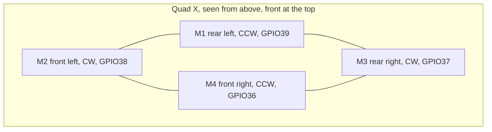
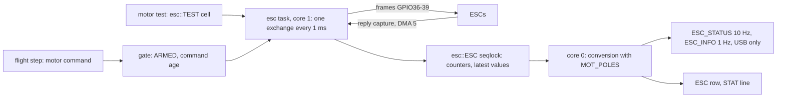

# ESC

Part of [MARV V2 firmware](../README.md)

Core 1's `esc` task drives four ESCs with bidirectional DShot300 on PIO2 and reads back their telemetry (eRPM, and voltage,
temperature and current through extended telemetry). It also carries the flight command's throttles while armed, and the motor test.
**The firmware sends DShot Stop frames on GPIO36-39 from every boot, whether or not a battery is connected.**

## Motor layout

| Motor | Position | Spin | GPIO | Driver line |
|---|---|---|---|---|
| M1 | rear left | CCW | 39 | 3 |
| M2 | front left | CW | 38 | 2 |
| M3 | rear right | CW | 37 | 1 |
| M4 | front right | CCW | 36 | 0 |

ESC_STATUS follows the M1 to M4 order.

## DShot and telemetry flow

- The task starts once at boot (lines released 3 s, a 25 ms break), then runs one exchange per millisecond for ever. A stall gives one late frame, never a burst.
- Frames are Stop on every line, except command 13 (extended telemetry on) in bursts of 10 frames on one line once that line has answered for 1 s with no extended reply, then a 1 s hold-off.
  With the feature `esc-no-edt` no burst starts.
- The task logs nothing and takes no lock; core 0 does all conversion.

## ESC row

`MARV_DEVICE_STATUS` device 12, report only (no SYS_STATUS bit), recomputed for every message (`fw_core::esc::verdict`):

| State | When |
|---|---|
| STARTING | start sequence running, or ended less than 5 s ago and not all four answering |
| ABSENT | no ESC has answered this boot |
| OK | all four answering (a good reply within 100 ms) |
| DEGRADED | 1 to 3 answering (TIMEOUT) |
| FAILED | none after some good reply (TIMEOUT), or data older than 1 s (STUCK) |

`[STAT] ESC:` every 10 s: the row, exchanges, longest and shortest exchange, per-motor good replies, non-replies, dropouts, EDT bursts, latest raw voltage, temperature, current, and `throttle frames N`.

## Flying, props off

**This firmware spins all four motors when the pilot arms it on the radio. Keep the propellers off unless told otherwise.**

- Arm: channel 5 goes from off to above 1800 us on a fresh CRSF report, with throttle low, valid attitude, lean within 30 deg, no settings save running and core 0's permit set. The motors then idle and the LED is purple.
- Core 0's permit (`fw_core::arming`, every 10 ms): the LED roll call has ended (9.15 s after boot), IMU1 and the ESC row are OK, and no calibration, action or motor-test spin runs.
  A refused arm gives three red LED flashes and one WARNING text ("Arming refused: booting", "IMU1 not OK", "ESC not OK", "busy").
- Disarm (Stop at once): switch off; no CRSF report for 1.0 s (`RC_FS_TIMEOUT`); a controller refusal; a gap over 100 ms between flight steps. The ESC task also sends Stop when the newest flight command is older than 10 ms.
- While armed, core 0 refuses every action and a motor-test spin; the motor test runs only while disarmed.

## Motor test

`MAV_CMD_DO_MOTOR_TEST` (209), the same on every link. **Propellers off only.**

| Parameter | Value |
|---|---|
| param1 | motor 1 to 4 |
| param2 | 0 (percent) |
| param3 | throttle 0 to 5.0 % (0 = stop now); the level sent is round(param3 x 20) of 2000, at least 1 |
| param4 | duration above 0, up to 3.0 s |
| param5, param6, param7 | 0 or 1, 0 or 2, 0 |

- Anything else (NaN included) is DENIED with `motor test: <reason>`. A stop is ACCEPTED in every state. A spin is ACCEPTED at once unless another action is booked, the vehicle is armed or flight throttles go out (TEMPORARILY_REJECTED).
- Core 0 writes `TestCmd { seq, line, level, until_us }` to the cell `esc::TEST`; core 1 reads it wait-free and ends the spin on its own clock (expiry, 3 s limit, stop, replaced, or its own 5 % cap guard). A hung core 0 cannot extend a spin.
- During a spin the tested line gets the throttle, the other three Stop, and no command 13 is sent.
- Core 0 prints `[INFO] motor test M<n>: level L, ended by <cause> after <ms> ms`; a `cap` ending also gives a WARNING text.
- If core 1 hangs, no frames go out and the ESC's own cut-off (about 510 ms without frames) is the last resort. A spin runs to its end even if the link drops (at most 3 s).
- Host tests: `cargo host-test -p fw-core` (`motor_test_*`), `-p fw-flight`.

## Code

| File | Role |
|---|---|
| `src/esc.rs` | the `esc` task, `ESC` and `TEST` cells, the report |
| `crates/fw-flight/src/esc.rs` | `Esc::frames`, `next_deadline`, `capped` |
| `crates/fw-core/src/esc.rs` | the row `verdict` |
| `crates/fw-core/src/admission.rs` | `classify_motor_test`, `MotorTest` |
| `src/actions.rs` | `motor_test` action |
| `crates/fw-core/src/arming.rs` | the arming permit |

Features: `esc-off` (task not built, ESC row FAILED, motor test unsupported), `esc-no-edt`.

## Related

[flight-core](flight-core.md) (mixer, gate) - [flight-modes](flight-modes.md) (arming) - [radio](radio.md) - [health](health.md) (LED) - [parameters](parameters.md) (`MOT_POLES`) - [device-layer](device-layer.md) - [pinout](pinout.md)
