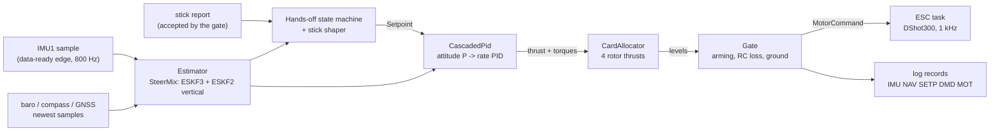

# Flight core

Part of [MARV V2 firmware](../README.md)

The flight core is core 1. It runs one flight step for every good IMU1 sample (about 800 Hz): estimate the vehicle state, turn the pilot's or the mission's
setpoint into a thrust and torque demand, allocate four rotor thrusts and hand a motor command to the ESC task. It is a pure library
(`crates/fw-flight`) that the board wraps in `src/flight.rs`; the same step runs in host tests.

## Per-sample pipeline

| What | Rate | Where |
|---|---|---|
| IMU sample (both IMUs, set at boot from `IMUn_*`) | 800 Hz default | `src/imu1.rs`, `crates/fw-flight/src/imu.rs` |
| Flight step | once per good IMU1 sample | `src/flight.rs`, `crates/fw-flight/src/step.rs` |
| ESC DShot output and eRPM reply | 1 kHz | `src/esc.rs` |
| Baro / compass / GNSS | about 50 Hz / 100 Hz / `GPS_RATE_MS` (200 ms) | [device-layer](device-layer.md) |

## Stages of one step

| Stage | What it does | Code |
|---|---|---|
| Latch | While disarmed, take the newest `PILOT_SPEED_XY`, `RPM_NOTCH_EN`, the 14 `ATC_*` gains and mission targets; they stay fixed until the next disarm | `step.rs` (`Flight::step`) |
| Accept report | The gate hands the step only reports of the flight's own link | `gate.rs` (`accepts`) |
| Estimate | `SteerMix`: an ESKF3-style full-aiding filter behind an output predictor (attitude, rates, horizontal state) plus a zero-delay ESKF2 (`Aiding::ImuBaro`) for height. A non-finite IMU value gives no tilt, so the demand is refused and the gate stops | `eskf.rs`, `eskf_out.rs`, `eskf_n0.rs` |
| Tier | Validity flags give T3 (position usable), T2 (height only), T1 (tilt and rates only) | `hands_off.rs` (`Tier`) |
| Mode in effect | Position if selected, covered by the estimate and airborne; else Altitude if covered; else Angle | `step.rs` (`StepOut.mode`) |
| Shape + hands-off | Sticks (or the state machine's synthetic sticks, or the guidance carrot) become a `Setpoint` | `hands_off.rs`, `guidance.rs`, `gnc.rs` |
| Control | `CascadedPid`: attitude P into a PID rate loop per axis; vertical loop for Altitude; horizontal position P / velocity PI for Position. RPM notch on the gyro rates (`RPM_NOTCH_EN`) | `pid.rs`, `notch.rs`, `tuning.rs` |
| Allocate | `CardAllocator` maps thrust and torques to four rotor thrusts with the vehicle card (`marv-card`: mixer matrix, `K_F`, levels). Yaw is given up first; no airmode | `alloc.rs` |
| Gate | The only producer of a spinning `MotorCommand` (its field is private) | `gate.rs` |
| Log | IMU / NAV / SETP / DMD / MOT every step while armed, ESC every 4th | `src/flight.rs`, [logging](logging.md) |

Pilot mapping (`tuning.rs`): `ANGLE_MAX` 30 deg, yaw rate 150 deg/s, horizontal speed `PILOT_SPEED_XY`. Gains and limits are compiled constants in
`Tuning::DEFAULT`, exposed as the 14 `ATC_*` parameters ([parameters](parameters.md)).

## The gate and the ground rule

`Gate::apply` is the last stage of every step. Its rules:

| Rule | Behaviour |
|---|---|
| Step gap | A gap over 100 ms between flight steps (`FLIGHT_GAP_DISARM_US`) disarms |
| RC loss | No report for over 1.0 s (`rc_fs_timeout_us`): Stop and disarm, unless armed and the hands-off state machine owns the flight |
| Arm switch off | A report with the switch off disarms at once (unless the hands-off state machine holds it, see [flight-modes](flight-modes.md)) |
| Arming | Switch cycled OFF then ON, throttle at or below `arm_thr_max` (0.05), tilt valid and within `ANGLE_MAX`, a controller output, not a receiver report with the mission switch ON |
| Not armed / no levels | Stop |
| Spinning | Each level clamped to `IDLE_LEVEL`..`LEVEL_MAX` |
| ESC age | A command older than `MOTOR_HOLD_MAX_US` is sent as Stop by the ESC task |

On the ground the gate gives Stop; LAND ends at touchdown with the motors stopped and the vehicle disarmed. See [esc](esc.md) for the DShot side.

## Estimator notes

- Inputs: both IMUs, baro, compass, GNSS. Heading trust is `[STAT] NAV` `valid 0x7f`; a compass health check (`MAG_HLT_STR`, `MAG_HLT_INC`) can withdraw heading.
- `mahony.rs` / `mahony_baro.rs` are an older estimator kept in the crate; they do not run on the board.
- The IMU task waits on the data-ready edge, not a timer, and verifies the chip configuration one register at a time between samples.

## Code

| File | Role |
|---|---|
| `src/flight.rs` | Core-1 wrapper: sample cells, parameter triple buffers, log cell, `[STAT] NAV` |
| `crates/fw-flight/src/step.rs` (+ `step/*_tests.rs`) | `Flight::step`, the stages in order |
| `crates/fw-flight/src/imu.rs` | `ImuTask`: sample loop over an `ImuAdapter` |
| `crates/fw-flight/src/eskf.rs`, `eskf_out.rs`, `eskf_n0.rs` | Estimator |
| `crates/fw-flight/src/pid.rs`, `notch.rs`, `tuning.rs` | Controller, RPM notch, gains and limits |
| `crates/fw-flight/src/alloc.rs` | Allocator |
| `crates/fw-flight/src/gate.rs` | Arming, RC loss, motor command |
| `crates/fw-flight/src/hands_off.rs`, `guidance.rs` | Mode state machine, mission legs |

## Related

[Architecture](architecture.md) · [Flight modes](flight-modes.md) · [Missions](missions.md) · [Parameters](parameters.md) · [ESC](esc.md) · [Logging](logging.md) · [Health](health.md) · [Device layer](device-layer.md)
