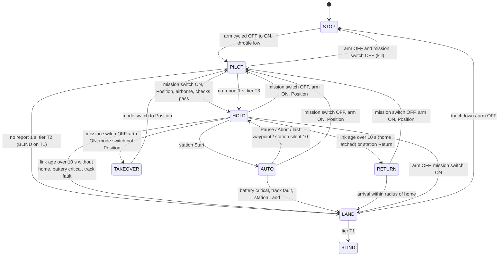

# Flight modes

Part of [MARV V2 firmware](../README.md)

The mode is the state of the hands-off state machine (`crates/fw-flight/src/hands_off.rs`), sent in HEARTBEAT `custom_mode`. Two radio models decide
what is possible: a CRSF model only ever flies PILOT; a MAVLink model also gets HOLD, AUTO, RETURN and TAKEOVER and a mission switch.

## Modes

| custom_mode | Mode | Meaning |
|---|---|---|
| 1 | PILOT | Pilot flies. Sub-mode from the mode switch (ch 6): Low Angle, Middle Altitude, High Position |
| 2 | TAKEOVER | Vehicle holds position, sticks ignored, until the pilot's hand-back conditions are met |
| 3 | HOLD | Position hold with centred synthetic sticks, sticks ignored |
| 4 | AUTO | Flying the uploaded waypoint list ([missions](missions.md)) |
| 5 | RETURN | Climb to the return height, straight leg home, then LAND |
| 6 | LAND | Controlled descent (1.5 m/s, slower near the ground); touchdown stops the motors |
| 7 | STOP | Disarmed, motors stopped |
| 8 | BLIND | LAND on tilt and rates only (tier T1); reported only |

Position and Altitude fall back to a lower mode when the estimate does not cover them (`StepOut.mode`).

## State diagram (MAVLink model)

## Transition table

MS = mission switch (ch 8) ON, A = arm ON, P = mode switch in Position. "Fresh" = newest report younger than 1.0 s. All rows are MAVLink flights.

| State | MS ON, A | MS OFF, A, P | MS OFF, A, not P | A OFF, MS ON | A OFF, MS OFF | No fresh report |
|---|---|---|---|---|---|---|
| PILOT | HOLD if P, airborne and the entry check passes (T3, no track fault, battery OK, link, arm ON); else PILOT | PILOT | PILOT | on ground STOP; else LAND | STOP | HOLD (T3), LAND (T2), BLIND (T1), STOP (ground) |
| TAKEOVER | stays | PILOT | stays | LAND | STOP | as PILOT |
| HOLD | stays (mode switch ignored; Start allowed) | PILOT, place dropped | TAKEOVER | LAND | STOP | stays; link age over 10 s gives RETURN (home + return built) else LAND |
| AUTO | stays | PILOT | TAKEOVER | LAND | STOP | stays; station silent 10 s gives HOLD, place kept |
| RETURN | stays | PILOT | TAKEOVER | LAND | STOP | stays |
| LAND / BLIND | unchanged | PILOT | TAKEOVER | stays | STOP | unchanged |

Priority in code: arm OFF columns (they read the newest report even if stale), the ground exit (not airborne, touchdown held: STOP), the MS OFF columns, each state's own exits
(tier lost, battery critical, track fault, link age, station loss, arrival), MS ON entry to HOLD, then station commands.

## Failsafe timings

| Event | Limit | Result |
|---|---|---|
| No fresh stick report | 1.0 s (`rc_fs_timeout_us`) | HOLD on T3, LAND on T2, BLIND on T1, STOP on the ground or if never airborne |
| Link age in HOLD (newer of stick report and station heartbeat) | 10 s (`LINK_LOSS_US`) | RETURN if home latched and RETURN built, else LAND |
| No station heartbeat in AUTO | 10 s (`STATION_LOST_US`) | HOLD, mission paused, place kept; Start again continues. Live sticks mean no RETURN |
| Tier drop | 1.0 s debounce (`TIER_DEBOUNCE_US`) | state exits take effect only after it |
| Battery critical or track fault in HOLD / AUTO / RETURN | immediate | LAND |
| Distance rule | D_max 10 m (`D_MAX_M`) | LAND must have started by then |

**Home latch.** Home is latched between arming and the first take-off, at the first valid position, and cleared at disarm. Taking off within a few seconds of arming means no home:
link loss then lands in place and Start is refused "no home point".

## The two RC links

| | CRSF model | MAVLink model |
|---|---|---|
| Transmitter | ELRS model sending CRSF (420000 baud) | ELRS model sending MAVLink (460800 baud); the receiver must be powered up on this model |
| Stick source | CRSF frames | `RC_CHANNELS_OVERRIDE` only from sender (255, 68) with none of ch 1-8 at 0 or 65535; any other sender (the station is 255/190) is never a stick report |
| Rate | about 245 /s | 100 /s |
| Arms | always | always (mission switch OFF) |
| Hands-off states | never HOLD / AUTO / RETURN: stick loss gives LAND (BLIND, or STOP on the ground); when reports return, TAKEOVER until the pilot gives control back | HOLD, AUTO, RETURN, TAKEOVER, mission switch |
| Station radio commands | refused, reason 3 | accepted |

The flight keeps the link type it armed on until disarm; reports from the other source are ignored for the rest of the flight (`gate.rs` latches the source; `hands_off.rs` `ho_allowed`). See [radio](radio.md).

## Channel map

| Channel | Function | Rule |
|---|---|---|
| 1 / 2 / 3 / 4 | roll / pitch / throttle / yaw | `RCMAP_ROLL/PITCH/THROTTLE/YAW` (1, 2, 3, 4) |
| 3 | throttle | arming needs throttle at or below 0.05 |
| 5 | arm switch | raw above 1800 us = ON, no calibration; a missing channel reads OFF |
| 6 | mode switch | thirds: Low Angle, Middle Altitude, High Position |
| 8 | mission switch | raw above 1800 us = ON; read only on a MAVLink flight |

## Arming and the mission switch

| Rule | Behaviour |
|---|---|
| Arming | Arm switch cycled OFF then ON, throttle low, tilt OK, a controller output, fresh report. Refused with MS ON on a receiver report |
| MS ON in the air | Armed + Position + airborne: PILOT goes to HOLD (sticks ignored). Start on the laptop then gives AUTO |
| Take control back | MS OFF with arm ON and Position: PILOT at once (also after a link gap). Mode switch not in Position: TAKEOVER until it is |
| Arm OFF, MS ON | Controlled LAND (BLIND on T1); stops on the ground. MS OFF + arm ON + Position returns control |
| Arm OFF, MS OFF | Motors stop at once, in the air too |
| In-air restart | After an arm-OFF STOP taken in the air (the state machine's ground test false: `HO 7 STOP arm-ms-off` or `arm-off`), arm back ON within 5 s while IMU1 reads free fall (below 0.25 g since the first low sample after the STOP, and on that step; the first 150 ms after the STOP, the prop spin-down, are ignored) arms with any throttle and lean; the switch cycle, tilt and rates valid, a controller output, core 0's permit and the MS rule still apply. An impact or any sample at or above 0.25 g (or not finite) ends it for good; a STOP on the ground never starts it. Any arming while it holds (low throttle too) flies Altitude when Angle is selected and the height estimate covers it (throttle stick at the bottom: 1.5 m/s descent), until the mode switch changes, and latches no home. The `restart-bench` feature forces it on a props-off bench ([build-and-test](build-and-test.md)) |
| Hand-back into Position | If sticks are off centre, the vehicle moves at up to `PILOT_SPEED_XY` horizontally and 3.0 / 1.5 m/s vertically |

## Code

| File | Role |
|---|---|
| `crates/fw-flight/src/hands_off.rs` | `State`, `Tier`, `Command`, `DenyReason`, the transition code (`mission_switch`, `lost`, `update_home`, `command`) |
| `crates/fw-flight/src/gate.rs` | Arming rules, link latch (`accepts`), the in-air restart latch (`stop`, `fall_step`) |
| `crates/fw-settings/src/rc.rs`, `src/rc.rs` | Switch decoding, channel map, `RC_CHANNELS_OVERRIDE` filter |
| `src/station.rs` | HEARTBEAT `custom_mode`, station commands |

## Related

[Flight core](flight-core.md) · [Missions](missions.md) · [Parameters](parameters.md) · [Radio](radio.md) · [Ground station](ground-station.md) · [Health](health.md)
