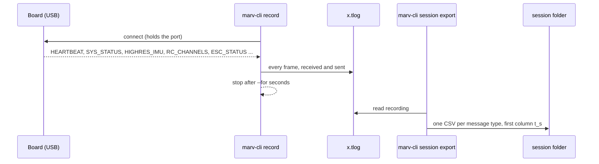

# Ground station

Part of [MARV V2 firmware](../README.md)

The firmware speaks MAVLink 2 (the `marv` dialect: `common` plus `MARV_TEST` and `MARV_DEVICE_STATUS`) to the ground station
[MARV-GCS](https://github.com/Lmx154/MARV-GCS): `marv-gcs`, a desktop window (egui), and `marv-cli`, a command line with no display. The wire rules
between board and station are in that repository's `docs/link-contract.md`. This page covers the firmware's side: the commands it accepts and how to record and read a session.

## Links

| Link | Id | Notes |
|---|---|---|
| USB (CDC) | 0 | full link: parameters, commands, mission upload, log download |
| ELRS radio | 1 | only while the receiver is in MAVLink mode; no log download (see [radio](radio.md)) |

`marv-gcs` also connects over TCP and UDP (for example through the transmitter's WiFi backpack, as a read-only "Operate" role that cannot write parameters).
`marv-cli --connect serial:/dev/serial/by-id/usb-MARV_MARV_V2_firmware_marv-v2-fw-if00` (or `udp:`, `tcp:`).

## Commands the firmware admits

Commands go through one `ActionBook` (`src/actions.rs`, admission in `fw_core::admission`). An admitted command answers IN_PROGRESS 0 %, then a final ACK follows; a denied one puts the reason out as a STATUSTEXT.

| `marv-cli` | What it does |
|---|---|
| `device restart IMU1 \| IMU2 \| BARO \| MAG \| GNSS \| BATT \| SD` | raises that row's RESTART; ACCEPTED when it reaches Ok, FAILED on Failed or Absent first |
| `device selftest MAG \| IMU1 \| IMU2` | the device must lie still; driver self-test, then a restart; ACCEPTED on a pass with the device back Ok |
| `param reset-all --yes`, `param reset-calibration --yes` | reset the store (or only the calibration values); affected devices get an APPLY |
| `param save` | writes the changed parameters to flash; ACCEPTED when read back and verified |
| `param reload` | the boot rule again from flash |
| `reboot --yes` | writes the REQUESTED record, ends ACCEPTED, then the watchdog monitor resets the board 100 to 200 ms after the final ACK; unsaved parameters are lost |
| `calibrate gyro \| accel \| compass \| cancel` | see [calibration](calibration.md) |
| motor test (DO_MOTOR_TEST 209) | see [esc](esc.md) |
| `logs list \| get` | log download, USB only: see [logging](logging.md) |
| `mission upload \| download \| clear`, flight commands | see [missions](missions.md), [flight-modes](flight-modes.md) |

`device restart RC`, any unsupported self-test, and any command or parameter the admission does not accept are DENIED. While armed or a motor-test spin runs, actions are refused.

## Other `marv-cli` commands

`status`, `devices`, `texts`, `watch`, `param list|get|set`, `record FILE --for s`, `session export|list`, and offline `log report|tune|survey`. Output is TAB-separated.

## Record a session and read it



```
marv-cli --connect serial:... record x.tlog --for 60 &
marv-cli session export x.tlog --name x --out <dir>
```

| CSV | Useful fields |
|---|---|
| `HEARTBEAT.csv` | `custom_mode` (1 PILOT, 2 TAKEOVER, 3 HOLD, 4 AUTO, 5 RETURN, 6 LAND, 7 STOP, 8 BLIND), `base_mode`, `system_status` |
| `RC_CHANNELS.csv` | `chan3_raw` throttle, `chan5_raw` arm, `chan6_raw` mode, `chan8_raw` mission switch |
| `ESC_STATUS.csv` | motor eRPM |
| others | `SYS_STATUS`, `HIGHRES_IMU`, `GPS_RAW_INT` (no latitude or longitude, for privacy), `MARV_DEVICE_STATUS`, `STATUSTEXT` |

`marv-cli` holds the serial port while it records, so run it in the background and read the CSVs afterwards. The window's own recordings are `.tlog` files too.
The firmware's own log (the `.BIN` on the SD card) is a different record: see [logging](logging.md).

## The station's crates

`gcs-transport`, `gcs-mavlink`, `gcs-link`, `gcs-dflog` (reads `.BIN` logs), `gcs-magcal` (guided compass fit), `gcs-sim` (a simulated vehicle), `marv-gcs`, `marv-cli`.
`marv-gcs` tabs: HUD, Sensors, Devices, Parameters, Map (waypoint editor and mission upload), Log (download and review), calibrations.

## Code (this repository)

| File | Role |
|---|---|
| `src/actions.rs` | the action book glue, command execution |
| `crates/fw-core/src/admission.rs` | which commands are accepted, denied or rejected |
| `src/station.rs` | flight commands and station heartbeat between the links and the flight core |
| `src/logdl.rs` | log download |
| `src/main.rs` | the USB node and its streams |

## Related

[radio](radio.md) (streams per link) - [logging](logging.md) - [calibration](calibration.md) - [esc](esc.md) - [flight-modes](flight-modes.md) - [missions](missions.md) - [parameters](parameters.md) - [device-layer](device-layer.md) - [health](health.md)
