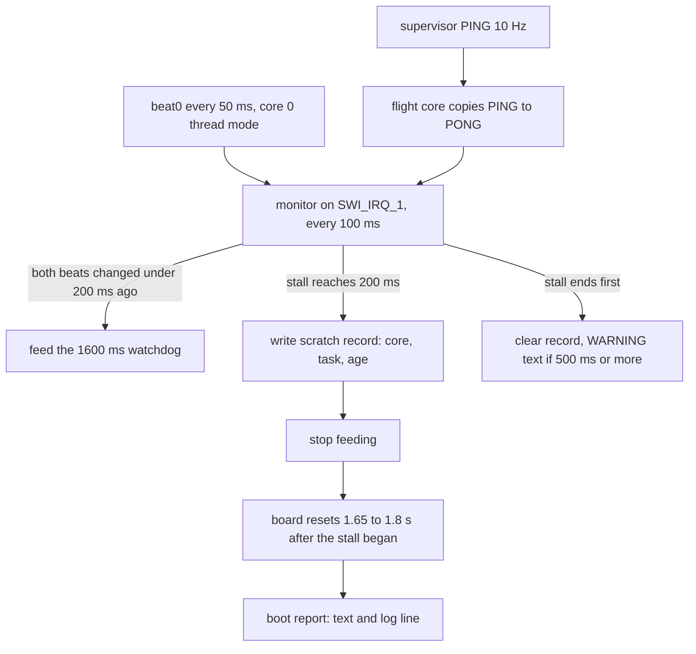

# Health

Part of [MARV V2 firmware](../README.md)

How the firmware watches itself and tells you: the core-0 supervisor, the periodic `[STAT]` lines, the hardware watchdog with its
boot report, and the one status LED.

## Supervisor

`supervisor` is a 10 ms tick task on core 0. It bumps `PING` at 10 Hz and kicks the flight core, tracks the age of `PONG`, gives the
start-up PASS/FAIL verdicts, runs the devices' stuck check and transition texts ([device-layer](device-layer.md)), ends the running
action (`actions::tick`), mirrors the flight rows every 10 ms, sets the arming permit, and writes `[STAT]` lines every 10 s
(`[STAT] BARO:`, `GNSS:`, `ESC:`, `SD:`, `watchdog:` and so on). `tools/run.sh` shows them.

## Watchdog

- Started first in `main`, 1600 ms, paused while the debugger halts a core. Fed ONLY by the monitor, never by a device task.
- **Resets the board:** core 0's thread-mode executor held, the flight core held, interrupts off or a hang inside a critical section (no record), a panic (no record), `reboot --yes`.
- **Does not:** a device stuck in an await, a device that fails (health goes to Failed), a flash save (about 45 ms), a stall under about 1.6 s.
- Each task stores its id when it resumes (`fw_core::watchdog::task`), so the record names the task that ran last on that core.

| Reset cause | Boot report (held until a station is connected) |
|---|---|
| time-out + stall record | CRITICAL "WDG reset: BARO stalled (core 0)" or "IMU1 stalled (flight core)" |
| time-out, no record | CRITICAL "WDG reset: no record" |
| forced + REQUESTED | INFO "reboot: requested" |
| forced, no record | WARNING "reset: forced, no record" |
| power-on or debugger | nothing |

A station can also tell from `time_boot_ms` going back to near zero and from the USB device re-enumerating. Nothing is kept in flash.
Check features (`hang-core0`, `hang-flight`, `spin-1s`, `hang-irqoff`, `wdg-scratch-probe`) each act once, 20 s after a start the watchdog did not cause.

## Status LED

The board's one LED (D20, a WS2812C on GPIO43) is driven by `src/led.rs` (core 0, watchdog id LED = 19, PIO1 SM1). Every 20 ms it reads the rows,
the motor test, the calibration flag, the open log and the GNSS sample, asks the pure `fw_core::led` what to show and writes only on change.

**Boot:** steady white; at 6.0 s a roll call of nine blinks in the order IMU1, IMU2, BARO, MAG, GNSS, BATT, RC, SD, ESC. Green = OK, red = FAILED, yellow = anything else.

**Running** (one soft pulse per second; the highest row that applies wins):

| Priority | Display | Meaning |
|---|---|---|
| 1 | red, double blink | IMU1, IMU2, BARO, MAG or BATT FAILED |
| battery | yellow blink 5 Hz (LOW), red blink 5 Hz (CRITICAL) | between rows 1 and 2; `BATT_LOW_CELL` |
| 2 | purple, solid | a motor is commanded (motor test spin, or armed flight throttles) |
| 3 | blue and white alternating, 5 Hz | a calibration is running |
| 4 | yellow pulse | any row DEGRADED or RECOVERING; GNSS, RC, SD or ESC FAILED; no log open |
| 5 | green pulse | GNSS sample younger than 3 s with a 3D fix |
| 6 | blue pulse | otherwise |

RC or ESC merely ABSENT or STARTING (radio off, no battery) is not yellow.

**Flashes:** three quick flashes over the running display: green when a settings save or a calibration ends ACCEPTED, red when one ends FAILED
(a calibration that runs out of time counts as FAILED), and red when core 0 refuses an arm. A cancelled calibration shows nothing.

Not shown on purpose: sensor reads, telemetry, radio or USB traffic, parameter writes, a battery above LOW, the watchdog's reset cause.
Brightness is `LED_BRIGHT` (0 off, 1 dim default, 2 medium, 3 bright).

## Code

| File | Role |
|---|---|
| `src/watchdog.rs` | monitor, `beat0`, scratch record, boot report |
| `crates/fw-core/src/watchdog.rs` | pure stall rules and task ids |
| `src/led.rs` | the LED task |
| `crates/fw-core/src/led.rs` | what to show |
| `src/main.rs` | the supervisor and the `[STAT]` lines |

## Related

[device-layer](device-layer.md) - [esc](esc.md) (arming refusals, ESC row) - [calibration](calibration.md) - [logging](logging.md) - [architecture](architecture.md) (cores, tasks) - [build-and-test](build-and-test.md) (feature flags)
