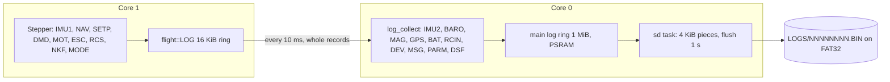

# Logging

Part of [MARV V2 firmware](../README.md)

Flight and device data are written to the microSD card as ArduPilot DataFlash `.BIN` logs (`LOGS/NNNNNNNN.BIN`), readable without
conversion by `mavlogdump.py`, MAVExplorer, UAV Log Viewer, Mission Planner and `marv-cli log report|tune`. Producers on both cores
push whole records into rings; the SD task is the one consumer and never blocks the flight core.

- A record that does not fit a ring is dropped and counted (FDS `Dp` for the flight ring, DSF `Dp` for the main ring); core 1 never waits, and a stalled card never backs up into it.
- With no log open, the collector consumes and discards flight records. Logging is off with `LOG_BACKEND_TYPE` = 0 (card untouched).
- The main ring holds about 13 s of a stalled card at a typical 75 KB/s log rate.
- Volume: about 166 kB/s armed, 62 kB/s disarmed.

## File format

`FMT` records first, then `A3 95 <type> <payload>` records, little-endian, `TimeUS` (board microseconds) first. Flight records reach the file up to about 10 ms
after core-0 records of the same time, so `TimeUS` is not in order across types.

## Record types

| Record | Rate | What |
|---|---|---|
| IMU (instance 0, IMU1) | every flight step armed (803.6 Hz), every 8th disarmed; the IMU record alone every step disarmed | the sample, so a log replays through the estimators |
| IMU (instance 1, IMU2) | 25 Hz | the second IMU |
| NAV, SETP, DMD, MOT | every step armed, every 8th disarmed | estimator output, setpoints, demands, motor outputs |
| ESC | every 4th step armed (200.9 Hz), every 8th disarmed | eRPM, volts, degC per DShot line, fresh bits |
| RCS | per stick report (up to about 250 Hz) | sticks and arm switch |
| NKF1, NKF2, NKI | per propagation (about 100 Hz armed) and per fusion | estimator state, biases, sigmas, fusion events |
| MODE | on change | selected and effective flight mode |
| SPN | with the step block, in Altitude | altitude setpoint |
| BFS | on a level change | low-battery monitor level |
| BARO, MAG | each new sample (about 50 Hz, 100 Hz) | pressure, temperature; calibrated field |
| GPS, GPA, GPV | each receiver sample | fix, accuracies (GPA), velocity (GPV) |
| BAT | 10 Hz | voltage, current |
| RCIN | 10 Hz while sticks are fresh | RC channels |
| RCL | 1 Hz while the radio link is up | RC port counters: mode, stick, link and RADIO_STATUS reports, bytes received, CRC errors, garbage bytes, UART errors, ms since the last station HEARTBEAT (`4294967295`: none); a gap in the counters or in RCL itself shows a dropout |
| DEV | 1 Hz and on state change | the 8 device rows |
| MSG | each STATUSTEXT | text (boot texts first) |
| PARM | all 128 at open and after each change | the parameter table |
| DSF, FDS | 1 Hz | drops and free space of the two rings |

Encoders are in `crates/fw-core/src/dflog.rs`. Hands-off events appear as MSG text "HO ...".

MSG texts of the station and hands-off path (logged only; a full ring drops them, never blocks):

| Text | When | Written by |
|---|---|---|
| `HO <code> <NAME> <reason>` | each hands-off state change, e.g. `HO 3 HOLD stn-lost`; the reason is `hands_off::Reason::token` (the initial `HO 7 STOP` has none) | flight core |
| `STN age <ms> ms gcs <sys>,<comp>` | after `HO 3 HOLD stn-lost`: the station HEARTBEAT's age and the RC port's latest ground-station sender (`none` when unknown) | flight core |
| `CMD <NAME> ok` / `CMD <NAME> den <code>` | each station flight command the step takes, its answer (`DenyReason::code`, 0 no answer) | flight core |
| `PLAN 0x<id> n=<k>` | first step and each change of the plan id the state machine sees (0x00000000 none) and its waypoints | flight core |
| `ARM no <why>` | each refused arm-switch OFF-to-ON edge, the first failed check: `thr`, `tilt`, `rates`, `lean`, `ctl` (no controller output), `ms` (receiver report with MS ON), `busy` (core 0 refused: save running or permit clear) | flight core |
| `FALL on` / `FALL off <why>` | the in-air restart's free-fall latch set (first sample below 0.25 g more than 150 ms after an in-air arm-OFF STOP), and why it ended: `impact` (a sample at or above 0.25 g), `f` (a non-finite sample), `late` (5 s passed); `FALL off ground` at an arm-OFF STOP on the ground (no restart) | flight core |
| `ARM fall t=<ms> f=<x100> thr=<x100>` | an arming with the in-air restart latch set (any throttle): ms since the STOP, IMU1's specific force (m/s^2 x100) and the throttle (x100) of the edge | flight core |
| `GCS HB <sys>,<comp>` | first time each ground-station HEARTBEAT sender is seen on the radio link since boot (at most 8); also sent as STATUSTEXT | core 0 (`rc`) |

Reason tokens: `armed`, `arm-off`, `arm-gnd`, `arm-ms-off`, `disarmed`, `landed`, `rc-lost`, `rc-back`, `handover`, `ms-off`,
`ms-on`, `tier`, `batt-crit`, `batt-low`, `track`, `link10s`, `plan`, `last-wp`, `stn-lost`, `home`, `start`, `pause`, `abort`, `rtl`,
`cmd-land`.

## SD card (device row)

`src/sd.rs`, task `sd`, drives the SD row through the same health machine as every device ([device-layer](device-layer.md)). It owns PIO0 SM0
(`pio-sdmmc`), DMA channel 4 on `DMA_IRQ_1`, the card and the FAT32 volume (`embedded-fatfs`).

- Start, recovery and restart are the same: a new bus, `init`, MBR partition 1 (type 0x0B or 0x0C), mount, open `LOGS/`. `device restart SD` takes up a changed card (there is no card detect).
- While mounted, the log writes are the liveness. A failed write is retried once; a second failure is one error event and the piece is dropped (a gap); three events make the row Recovering, and the recovery opens the next log.
- Used space is the sum of the files in `LOGS/` (free space is never asked of the file system).

| Condition | Row | Text |
|---|---|---|
| mounted, log open | Ok | NOTICE "SD: 59.5 GiB FAT32, 17 MiB in 2 logs, log 3" |
| clean-up deleting an old log | Starting | NOTICE "SD: clean-up, deleting log N" |
| card full | Failed | ERROR "SD: card full" |
| no card | Absent, TIMEOUT | ERROR "SD: no card" |
| no FAT32 in MBR partition 1 | Failed, ID_MISMATCH | ERROR "SD: no FAT32 volume, reformat as FAT32" |
| `LOG_BACKEND_TYPE` = 0 | Absent, NONE | INFO "SD: logging off" |

## Files and clean-up

- `LOGS/NNNNNNNN.BIN`, numbers 1 to 500 then 1 again; `LOGS/LASTLOG.TXT` holds the last number. One log per boot, and a new number after every recovery or RESTART.
- Before a log opens (never while one is written) the oldest logs are deleted while the logs together exceed the volume minus 500 MiB. Under 8 MiB left even without the other logs: no log, row Failed.
  A long deletion delays the start of logging (about 50 s for 161 MB); the row stays Starting and is not flagged stuck.
- FAT is not power-safe: a power cut or reset loses what was not yet flushed (about 1 to 2 s).

## Log download (USB only)

ArduPilot's MAVLink log download: LOG_REQUEST_LIST 117 -> LOG_ENTRY 118, LOG_REQUEST_DATA 119 -> LOG_DATA 120, LOG_REQUEST_END 122.
Not offered: LOG_ERASE, the radio link, MAVFTP. The open log is listed with its size at the last flush. The SD task answers one small step at a time, only when no log piece or flush is due, through a
second read-only handle, and hands records tagged with a generation number through a 4 KiB ring; a replaced transfer's bytes are never sent. While the SD row is not Ok a request gets no answer.
From the PC: `marv-cli logs list|get` (see [ground-station](ground-station.md)).

## Code

| File | Role |
|---|---|
| `src/logger.rs` | `log_collect`, the main ring, record writers |
| `src/sd.rs` | the SD task: mount, write, clean-up, row |
| `src/logdl.rs` | log download over USB |
| `crates/fw-core/src/dflog.rs`, `logfile.rs`, `mbr.rs` | encoders, file numbering and clean-up planner, MBR |
| `crates/fw-core/src/xcore.rs` (`LogRing`), `relay.rs` | the rings and the move between them |

Test hooks (Cargo features): `inject-sd-write-fail`, `log-verify`, `inject-log-small-volume`, `inject-log-delete-big`.

## Related

[device-layer](device-layer.md) - [flight-core](flight-core.md) (what the flight records hold) - [health](health.md) - [parameters](parameters.md) (`LOG_BACKEND_TYPE`) - [ground-station](ground-station.md) - [architecture](architecture.md) (PSRAM) - [resources](resources.md)
