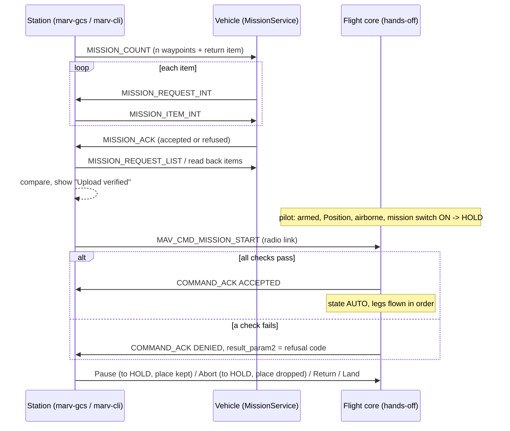

# Waypoint missions

Part of [MARV V2 firmware](../README.md)

A mission is a list of up to 16 waypoints plus a return item, uploaded from the ground station over the MAVLink mission protocol and held in RAM. In the air the pilot
puts the vehicle in HOLD with the mission switch; the station's Start command then flies the list as AUTO. Everything about the modes themselves is in [flight-modes](flight-modes.md).

## Upload and flight

Upload: station Map tab, "Waypoints" panel, "Upload to vehicle"; or `marv-cli mission upload|download|clear FILE.waypoints` ([ground-station](ground-station.md)). Plan type 0, frame 3
(relative altitude), over USB or the radio. The vehicle side is `MissionService` (`crates/fw-core/src/mission.rs`) driven by `src/mission.rs`: one transaction at a time, retries every 1.5 s up to 5 times, replies
40 ms apart on the radio. The list is RAM only and is lost at power cycle. Uploads are accepted while armed.

## Limits

| Limit | Value |
|---|---|
| Waypoints | up to 16, plus a mandatory last return item (`MAV_CMD_NAV_RETURN_TO_LAUNCH`, x = y = 0) whose z is the return height; 17 items max |
| Item rules | waypoints are command 16, frame 3 (or 6); lat within +-90, lon within +-180; z finite and within `GDN_ALT_MIN`..`GDN_ALT_MAX` (defaults 5..50 m), checked at upload (INVALID_PARAM7 for height) |
| Distance | vehicle and every waypoint within 1 km of home (`HOME_RANGE_M`) at Start |
| Return height | the return item's z, capped at `GDN_ALT_MAX`, never lower than the present height above home |
| Arrival radius | `GDN_RADIUS` (default 2.0 m, range 0.05..10) |
| Cruise speed | min(`PILOT_SPEED_XY`, 6.8 m/s); climb at most 3.0, descent at most 1.5 m/s, vertical acceleration 1.0 m/s^2 (`LEG_ACC_Z_MSS`); carrot acceleration 3 m/s^2 |
| Guidance source | `GDN_SRC` 1 uses the uploaded list; 0 uses `GDN_COUNT` / `GDN_LAT1..4` / `GDN_LON1..4` |

## Start preconditions and refusal codes

Start is `MAV_CMD_MISSION_START` from state HOLD. It must arrive on the radio link. The first failing check answers `COMMAND_ACK` DENIED with the code in `result_param2`
(`DenyReason::code`, checks in `start_check`, both in `hands_off.rs`):

| Order | Check | Code |
|---|---|---|
| a | command arrived on the radio (USB commands refused) | 1 |
| b | flight armed on CRSF / `FS_HOLD_EN` 0 | 3 |
| c | state is not HOLD (or AUTO already) | 4 |
| 1 | station heartbeat heard within 5 s | 5 |
| 2 | a list with a waypoint stored and `GDN_SRC` is 1 | 6 (none stored), 20 (stored but `GDN_SRC` not 1) |
| 3 | every z within `GDN_ALT_MIN`..`GDN_ALT_MAX` | 7 |
| 4 | home latched | 8 |
| 5 | vehicle position valid and within 1 km of home | 9 |
| 6 | waypoint distance known / all within 1 km | 10 / 11 |
| 7 | heading monitor OK and no track fault | 12 |
| 8 | position tier T3 | 13 |
| 9 | battery known non-critical | 14 |
| 10 | live receiver report younger than 1.0 s with mission switch ON / arm ON / mode switch in Position | 19 / 15 / 16 |

Other codes: 2 (a fresh CRSF stick report: station commands are refused while the sticks come over CRSF), 17 battery critical and 18 link lost (on entering HOLD or RETURN: Pause, Abort, Return). 0 is unknown. The station shows one result line per
command ("sent, waiting", "ACCEPTED by the vehicle", "REFUSED: reason", "NO ANSWER", "NOT SENT").

## Guidance behaviour

`crates/fw-flight/src/guidance.rs` (`LegGuidance`, wired in `step.rs`): a "carrot" moves along each straight leg at cruise speed and brakes to stop at the waypoint. The controller tracks the carrot
position with velocity feed-forward (`Setpoint::Position`). The carrot stops advancing when the vehicle lags more than 2 m (`LAG_E_MAX_M`); expect corner cutting up to 2 m and a height sag while moving.

| Event | Result |
|---|---|
| Waypoint k reached (within `GDN_RADIUS`) | next leg starts from it |
| Last waypoint reached | HOLD at its height |
| Pause | AUTO to HOLD, place kept; Start again continues from the kept place |
| Abort | HOLD, place dropped |
| Return | climb in place to the return height, straight leg home at that height, within the radius LAND |
| Land | controlled descent |
| New list uploaded while holding | kept place dropped |
| Station silent 5 s in AUTO | HOLD, place kept |

## Code

| File | Role |
|---|---|
| `src/mission.rs` | Both links' mission frames into `MissionService`; upload gate |
| `crates/fw-core/src/mission.rs` | `MissionService`: protocol, item validation, storage, guidance targets |
| `crates/fw-flight/src/guidance.rs` | `LegGuidance` carrot |
| `crates/fw-flight/src/hands_off.rs` | `start_check`, `DenyReason`, AUTO / RETURN / commands |

## Related

[Flight modes](flight-modes.md) · [Flight core](flight-core.md) · [Parameters](parameters.md) (`GDN_*`) · [Radio](radio.md) · [Ground station](ground-station.md)
