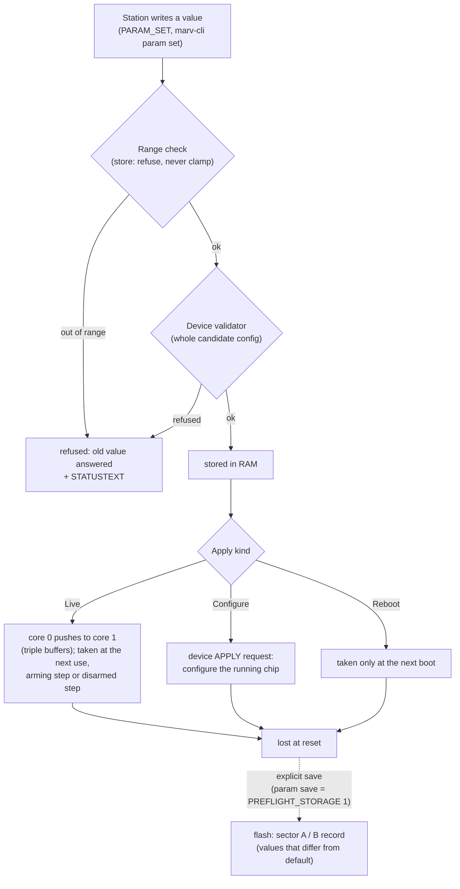

# Parameters

Part of [MARV V2 firmware](../README.md)

Every setting is a MAVLink parameter in one RAM store (`src/store.rs`). The full table is `fw_settings::TABLE` (`crates/fw-settings/src/lib.rs`, 128 entries), the concatenation
of one table per device module: baro, mag, batt, imu, sd, rc, esc, led, gnss and flight. A write takes effect in RAM at once but reaches flash only through an explicit save.

## Life of a write

## Apply kinds

| Kind | Meaning | Examples |
|---|---|---|
| `Live` | Read by running code on its next use. Flight values reach core 1 through triple buffers; several are taken only at the arming step or on a disarmed step | `PILOT_SPEED_XY`, `ATC_*`, `GDN_*`, `BATT_*`, `RC*` |
| `Configure` | Through the device's `configure`; the device's whole candidate config is validated before storing | `BARO_*`, `MAG_ODR_HZ`, `MAG_AVG`, `GPS_RATE_MS` |
| `Reboot` | Only after a reboot | `IMUn_ACC_FS`, `IMUn_GYR_FS`, `IMUn_ODR_HZ`, `SD` backend |

A refused write is answered with the old value and one STATUSTEXT "NAME: reason". Every write has an `[INFO] param NAME = value` log line.

## Flash

| Rule | Behaviour |
|---|---|
| Save | Only `MAV_CMD_PREFLIGHT_STORAGE` param1 = 1 (`marv-cli param save`). No automatic save, none after a calibration. `param reset-all` resets RAM only |
| Layout | Two 4096-byte sectors A (0x101FE000) and B (0x101FF000), one record each, holding only values that differ from default. A save writes the sector that does not hold the current record, reads back and compares |
| Boot | Both sectors read; the valid record with the highest sequence wins. Unknown, wrong-type or out-of-range entries are skipped with a WARNING. Nothing valid: defaults |
| Device check | At boot and reload, each device's stored set goes through its validator; a refused set puts that device's `Configure` and `Reboot` parameters back to defaults in RAM |
| Refusals | Save is refused while armed, or if the flight core does not answer |
| Stall | A flash erase/program stalls both cores for tens of ms; tools/run.sh re-flashes only the program, so settings survive |
| Reload | `param reload` repeats the boot rule |

Code: `src/settings.rs`; record format `fw_core::record`. See [architecture](architecture.md) for the flash layout.

## Flying-relevant parameters

### Flight

| Name | Default | Range | Meaning |
|---|---|---|---|
| `PILOT_SPEED_XY` | 5.0 m/s | 3..20 | Horizontal speed at full stick; caps hands-off and mission cruise speed. Taken at arming |
| `RPM_NOTCH_EN` | 0 | 0..1 | Gyro RPM notch on/off. Taken at arming |

### Guidance and mission

| Name | Default | Range | Meaning |
|---|---|---|---|
| `GDN_SRC` | 0 | 0..1 | 1: guidance and Start use the uploaded mission; 0: the `GDN_*` parameters. Start refused (code 20) if a list is stored and this is 0 |
| `GDN_ALT_MIN` / `GDN_ALT_MAX` | 5 / 50 m | 3..120 | Height limits for uploaded waypoints and the return item |
| `GDN_RADIUS` | 2.0 m | 0.05..10 | Waypoint arrival radius |
| `GDN_COUNT` | 0 | 0..4 | Number of parameter targets (0 = off; used when `GDN_SRC` 0) |
| `GDN_LAT1..4`, `GDN_LON1..4` | 0 | lat +-900000000, lon +-1800000000 | Target positions, 1e-7 degree |

### Controller gains (taken at arming)

All `Live` `F32`; defaults are `Tuning::DEFAULT` (`crates/fw-flight/src/tuning.rs`), ranges are `Gains::MIN` to `Gains::MAX`.

| Name | Default | Range |
|---|---|---|
| `ATC_ANG_RP_P` | 4.5 | 1.5..12 |
| `ATC_ANG_YAW_P` | 1.35 | 0.45..4.05 |
| `ATC_RAT_RLL_P` / `_PIT_P` / `_YAW_P` | 0.166 / 0.159 / 0.0886 | 0.0553..0.498 / 0.0530..0.477 / 0.0295..0.266 |
| `ATC_RAT_RLL_I` / `_PIT_I` / `_YAW_I` | 0.166 / 0.159 / 0.00886 | 0.0553..0.498 / 0.0530..0.477 / 0.00295..0.0266 |
| `ATC_RAT_RLL_D` / `_PIT_D` | 0.00746 / 0.00716 | 0.00248..0.0224 / 0.00238..0.0215 |
| `ATC_RAT_RLL_IMAX` / `_PIT_IMAX` / `_YAW_IMAX` | 0.273 / 0.249 / 0.0355 | 0.0910..0.819 / 0.0830..0.747 / 0.0118..0.107 |
| `ATC_RAT_FLTD` | 20 Hz | 6.66..60 |

### Battery (device BATT)

| Name | Default | Range | Meaning |
|---|---|---|---|
| `BATT_CELLS` | 4 | 0..12 | Cells in series; 0 = monitor off |
| `BATT_LOW_CELL` / `BATT_CRT_CELL` | 3.6 / 3.5 V | 3.0..4.2 | LOW and CRITICAL thresholds per cell |
| `BATT_LOW_TIMER` | 10 s | 0..120 | Voltage must stay below a level this long |
| `BATT_FS_CRT_ACT` | 0 | 0..1 | What CRITICAL does: 0 warn, 1 descend |
| `BATT_V_SCALE` / `BATT_A_SCALE` / `BATT_A_OFFSET` | 1.0 / 0.02 / 0 | 0.1..10 / 0..10 / -3.3..3.3 | ADC calibration |

### Sensors and radio

| Name | Default | Range | Meaning |
|---|---|---|---|
| `MAG_HLT_STR` / `MAG_HLT_INC` | 10 % / 10 deg | 1..50 / 1..45 | Compass health test tolerances; loosening them risks a bad heading |
| `IMUn_ACC_FS` / `IMUn_GYR_FS` / `IMUn_ODR_HZ` | 16 g / 2000 dps / 800 Hz | chip-offered values | IMU config, `Reboot` |
| `GPS_RATE_MS` | 200 ms | 100, 200, 500, 1000 | GNSS fix interval |
| `RC1..8_MIN/TRIM/MAX/REVERSED/DZ`, `RCMAP_*` | 1100 / 1500 / 1900 / 0 / 0 | 800..2200 us (REVERSED 0..1, DZ 0..200) | Stick calibration and mapping |
| `MOT_POLES` | 14 | 2..64 | Motor pole count for eRPM ([esc](esc.md)) |
| `LED_BRIGHT` | 1 | 0..3 | Status LED brightness |

Device parameter tables (BARO, MAG offsets and calibration, IMU orientation, SD) are listed in the per-device modules of `crates/fw-settings/src`; see [device-layer](device-layer.md) and [calibration](calibration.md).

## Code

| File | Role |
|---|---|
| `crates/fw-settings/src/lib.rs` | `TABLE`: all 127 definitions, in order |
| `crates/fw-settings/src/flight.rs` | Flight, guidance and gain parameters |
| `crates/fw-settings/src/{baro,mag,batt,imu,sd,rc,esc,led,gnss}.rs` | Per-device tables and validators |
| `crates/fw-core/src/params.rs` | `Params` store, `ParamDef`, `Apply` |
| `src/store.rs` | The RAM store shared by node, actions and device tasks |
| `src/settings.rs` | Flash record, boot load, guarded save |
| `src/flight.rs` | Triple buffers to core 1 |

## Related

[Flight core](flight-core.md) · [Flight modes](flight-modes.md) · [Missions](missions.md) · [Device layer](device-layer.md) · [Ground station](ground-station.md) · [Architecture](architecture.md) · [Calibration](calibration.md)
