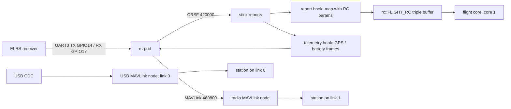
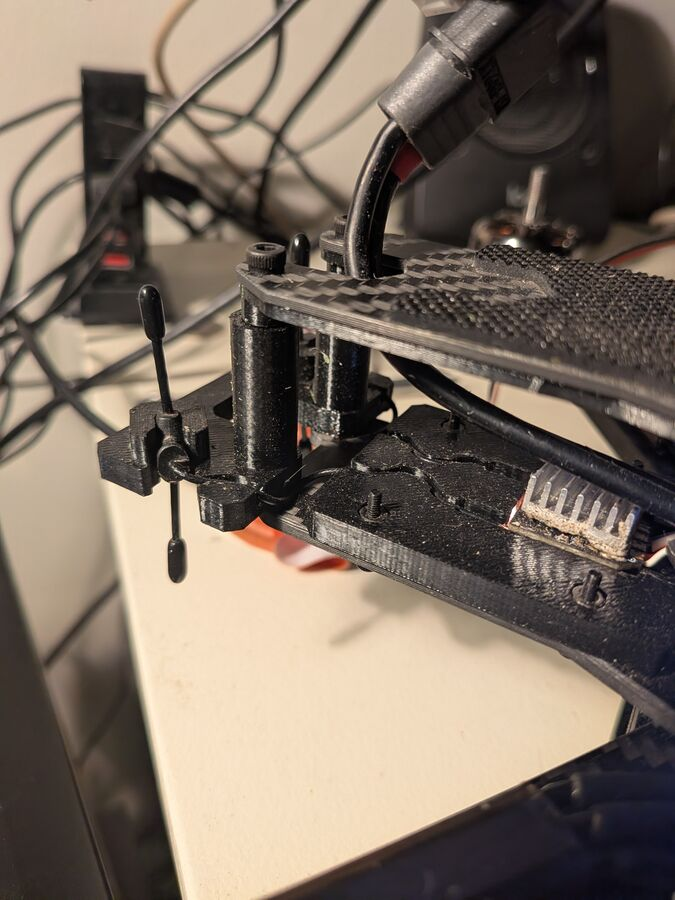

# Radio

Part of [MARV V2 firmware](../README.md)

The ELRS receiver is wired to UART0 (`rc-port`). The port follows the receiver by itself between CRSF (420000 baud) and MAVLink (460800 baud).
In CRSF mode it delivers pilot sticks to the flight core and sends telemetry back; in MAVLink mode it carries the radio's MAVLink node
(system 1, component 1, link 1). The USB link is a second MAVLink node (link 0).

<em>The ELRS receiver antenna on its printed mount.</em>

## Task and row

- `src/rc.rs`, task `rc_link` (watchdog id RC = 13), alone on core 0's `SWI_IRQ_0` interrupt executor at priority P3 (below the
  hardware interrupts and the watchdog monitor, above thread mode). UART0 is a `BufferedUart` (interrupt driven, no DMA, 256-byte rings); the RX pad's pull-up is turned on after the UART is built.
- The RC row (`MARV_DEVICE_STATUS` device 7, SYS_STATUS RC_RECEIVER) is report only: no health machine, no restart (`device restart RC` is denied).
  It means "the radio link is up" (`fw_core::rc::verdict`):

| Situation | Row |
|---|---|
| CRSF lock, stick report younger than 1 s | OK |
| MAVLink lock, RADIO_STATUS younger than 1 s with `rssi` above 0 | OK |
| either lock otherwise | DEGRADED, TIMEOUT |
| searching, no lock yet since boot | STARTING (DEGRADED after a first lock was lost) |

## Sticks to the flight core

The report hook maps each CRSF stick report with its own copy of the RC parameters (re-read every 64th report) and writes
`RcSample { sticks, arm, t_us }` to `rc::FLIGHT_RC`. `arm` is channel 5 above 1800 us. A MAVLink RC_CHANNELS_OVERRIDE is never written, so the MAVLink
model cannot arm or fly. Arming and RC loss are decided on core 1: see [flight-modes](flight-modes.md) and [esc](esc.md).

## What each link carries

| Message | USB (link 0) | Radio (link 1, while locked on MAVLink) |
|---|---|---|
| HEARTBEAT, SYS_STATUS | 1 Hz | 1 Hz |
| MARV_DEVICE_STATUS | 9 rows, 4 per batch every 333 ms | one row per second, a changed row goes out of turn |
| GPS_RAW_INT | 1 Hz | every 2 s |
| HIGHRES_IMU, SCALED_IMU2, SCALED_PRESSURE | 25 Hz each | 1 Hz each (same builders as USB) |
| RC_CHANNELS (65) | 5 Hz while sticks are fresh, 16 channels in us | none |
| MANUAL_CONTROL (69) | 5 Hz while the latest report is CRSF and fresh | none |
| ESC_STATUS, ESC_INFO | 10 Hz, 1 Hz (see [esc](esc.md)) | none |
| STATUSTEXT | text ring, link 0 | text ring, link 1 |
| Parameters, commands | on request, ACK on the origin link | the same |
| Log download | LOG_REQUEST_LIST / DATA / END (see [logging](logging.md)) | not offered |

- The streams' intervals are their defaults: a station can slow or stop one with SET_MESSAGE_INTERVAL but not raise it. The node also slows itself from RADIO_STATUS `txbuf`.
- The radio's MAVLink budget is about 274 B/s plus texts (up to 66 B each).
- A parameter change on one link is echoed on that link only; both nodes share one store (`store::Store`) whose mutex serialises writes.
- Texts: one ring (`fw_core::text_ring`, 8 entries), a cursor per link, each text once per link; boot texts sit in 2 sticky slots until every link took them.

## CRSF telemetry

The port calls the telemetry hook at most every 100 ms. If the GNSS row has a newer sample than the last one sent, the hook sends a GPS frame
(type 0x02) instead of the battery frame, at most once per second; otherwise the battery frame from the BATT row while it is younger than 1 s
(remaining percent and capacity 0). That is about 1 GPS frame and 9 battery frames per second. GPS values: latitude and longitude in 1e-7 degree, ground speed in
0.1 km/h, heading in 0.01 degree, altitude in whole metres above sea level (clamped), satellites used; zeros before a fix and after a loss.
The hook only copies the latest samples and encodes into the port's buffer.

## Code

| File | Role |
|---|---|
| `src/rc.rs` | `rc_link` task, report and telemetry hooks, `FLIGHT_RC`, `manual_control` |
| `src/main.rs` | the USB node task, stream tables, `push_*` message builders |
| `src/station.rs` | flight commands, mode and station heartbeat between the links and the flight core |
| `crates/fw-core/src/rc.rs` | `verdict`, `crsf_sticks`, `crsf_gps` (host-tested) |
| `crates/fw-core/src/text_ring.rs` | the STATUSTEXT ring |

## Related

[flight-modes](flight-modes.md) (CRSF vs MAVLink model, channel map) - [parameters](parameters.md) (`RC_*`) - [device-layer](device-layer.md) - [esc](esc.md) - [health](health.md) - [ground-station](ground-station.md) - [architecture](architecture.md)
