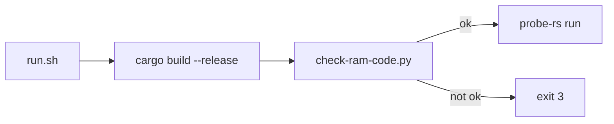

# tools

Part of [MARV V2 firmware](../README.md)

Two scripts: one builds, guards, flashes and runs; one is the guard that keeps the flight core's code out of flash.

| File | What it does |
|---|---|
| `run.sh` | Builds release, runs the guard, flashes through the debug probe with `probe-rs`, runs for a timeout, prints the report lines and keeps the full log under `logs/` |
| `check-ram-code.py` | Static check of the linked ELF: nothing core 1 can reach may lie in flash or PSRAM |

## run.sh

`[FEATURES=<features>] [BIN=<bin>] [ATTACH=1] [NO_CATCH_HARDFAULT=1] tools/run.sh [seconds, default 120]`

| Exit | Meaning |
|---|---|
| 124 | Normal end (the firmware runs until the timeout) |
| 3 | Guard result was not the expected one; nothing flashed |
| 1 | Probe lost contact, or a build error |

`ATTACH=1` reads the log of the running image without flashing. `NO_CATCH_HARDFAULT=1` lets the watchdog reset the board on a
HardFault. The script takes a probe lock so two runs wait for each other.

## check-ram-code.py

`python3 tools/check-ram-code.py <elf>`. From the flight core's roots (`core1_main` and its interrupt handlers) it follows
branches, address constants and the pointers inside constants. Exit 0 pass, 1 a reachable function, data object or constant in
the flash or PSRAM window (printed with its call chain), 2 tool error. With feature `ram-negative` or `psram-negative` it must
fail. Needs python3 and `arm-none-eabi-readelf`/`objdump`.

Nodes: [build and test](../docs/build-and-test.md), [architecture](../docs/architecture.md). Back to the [README](../README.md).
